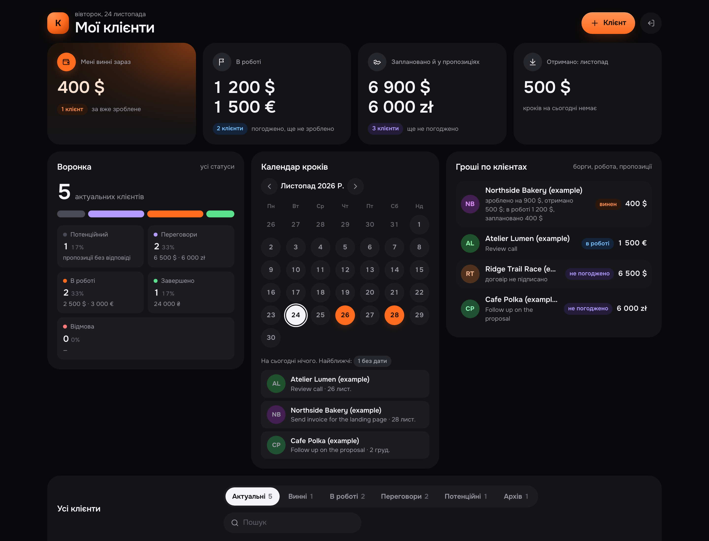
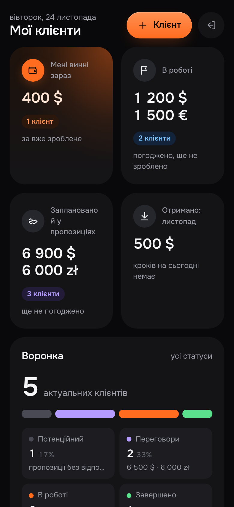

# Freelance Clients

[](LICENSE)
[](https://developers.cloudflare.com/workers/)
[](#how-it-is-built)

Made by **[Andrii Kolodiazhenskyi](https://andrii-designer.com)**, product designer & design engineer.

A small, private client tracker for one freelancer. See who owes you money, what is in progress, what is only proposed, and what your next step is with each client. Works on a phone and a laptop.

It runs on your own Cloudflare account (free plan is enough): one Worker, one D1 database, no frameworks, no build step.





> The interface is in Ukrainian. All strings live in `public/index.html`, so translating is a find-and-replace job.

## What it does

- **Money cards.** Owed to you now (done work minus payments), in progress (agreed, not done yet), planned and proposed (not agreed), received this month. Each currency is counted separately.
- **Every work item has a state.** Done, in progress or planned. Payments cover done work first; an advance beyond that reduces in-progress, then planned.
- **Funnel** by client status: lead, talks, active, done, lost.
- **Calendar of next steps** with overdue days in red.
- **Client list** with search, filters and a paid / owed / in progress bar.
- **Client card.** Contacts (Telegram, WhatsApp, email, phone, Instagram, site; the type is guessed from what you type), works and amounts, payments, contract status, next step, notes.
- **Login** with your own username and password. Sessions last 30 days; 5 wrong attempts from one IP lock login for 15 minutes.

## Set up (about 10 minutes)

You need Node.js 18+ and a Cloudflare account.

The easiest start: click **Use this template → Create a new repository** at the top of this page, then clone your copy. Or clone this repo directly:

```bash
git clone https://github.com/Andriikokyi/freelance-clients.git
```

```bash
cd freelance-clients && npm install
```

```bash
npx wrangler login
```

Create the database and copy the `database_id` it prints into `wrangler.jsonc`:

```bash
npx wrangler d1 create freelance-clients
```

Create the tables:

```bash
npm run db:init
```

Deploy:

```bash
npm run deploy
```

Set your login. Each command asks for a value; type it and press Enter:

```bash
npx wrangler secret put APP_USER
```

```bash
npx wrangler secret put APP_PASSWORD
```

```bash
openssl rand -base64 48 | npx wrangler secret put SESSION_SECRET
```

Open the `*.workers.dev` address that `deploy` printed and sign in. To add a home-screen icon on iPhone: Share → Add to Home Screen.

## Run it locally

```bash
cp .dev.vars.example .dev.vars
```

```bash
npm run db:init:local && npm run db:seed:local
```

```bash
npm run dev
```

The seed adds six fictional clients marked "(example)". Log in with the values from `.dev.vars`.

## How it is built

| File | What it is |
|---|---|
| `src/worker.js` | Login, signed session cookie, JSON API for clients (`GET/PUT/DELETE /api/clients`) |
| `public/index.html` | The whole app: HTML, CSS and vanilla JS in one file |
| `schema.sql` | Two tables: `clients` (one JSON document per client) and `login_fails` |
| `calc.check.js` | A tiny test for the money maths: `npm run check` |
| `seed.example.sql` | Fictional clients for local testing |

Each client is stored as one JSON document, so adding a field means editing only `public/index.html`.

## Security notes

- Without a valid session the API returns `401`; the page itself shows only the login form.
- The password is compared through HMAC, so its length and timing don't leak.
- The session cookie is `HttpOnly`, `Secure`, `SameSite=Strict`. Changing `SESSION_SECRET` signs everyone out.
- Saving requires `application/json`, which a cross-site form cannot send; together with `SameSite=Strict` this blocks cross-site requests.
- This is built for one person. There are no user accounts or roles.

---

## Українською

Автор: **[Андрій Колодяженський](https://andrii-designer.com)**, продуктовий дизайнер і дизайн-інженер. Потрібен схожий інструмент під ваш бізнес? Пишіть через портфоліо.


Простий особистий трекер клієнтів для фрилансера: хто скільки винен, що в роботі, що лише запропоновано, і який наступний крок з кожним клієнтом. Працює з телефона й ноутбука.

Розгортається на твоєму власному акаунті Cloudflare (вистачає безкоштовного тарифу): один Worker і одна база D1, без фреймворків і збірки.

**Як запустити:** виконай команди з розділу «Set up» вище по черзі. Коротко: клонуй репозиторій, створи базу D1 і встав її `database_id` у `wrangler.jsonc`, створи таблиці (`npm run db:init`), задеплой (`npm run deploy`) і задай логін, пароль та `SESSION_SECRET` через `wrangler secret put`.

**Що всередині:** картки з грошима (винні зараз, в роботі, заплановано, отримано за місяць), воронка за статусами, календар наступних кроків, список клієнтів з пошуком і фільтрами, картка клієнта з контактами, роботами, оплатами й нотатками.

## About the author

I'm **Andrii Kolodiazhenskyi**, a product designer who also writes the code. I built this tracker for my own freelance work, after losing track of who still owed me money, and decided to share it.

I design and build websites, apps and internal tools like this one, mostly for SaaS, sport, outdoor and travel businesses. Other things I made: [Wayly](https://wayly.cc), a fog-of-war map app for hikers and runners, and [Startlek](https://startlek.com), a sports events calendar.

**Need a tool like this shaped around your business, or a product designer who ships?** Get in touch:

[Portfolio](https://andrii-designer.com) · [LinkedIn](https://www.linkedin.com/in/andriy-ko) · [Instagram](https://www.instagram.com/andrii.designer.engineer_)

If this project saves you time, a ⭐ on the repo helps other freelancers find it.

## License

MIT. Use it, change it, sell your own version. A link back is nice but not required.
